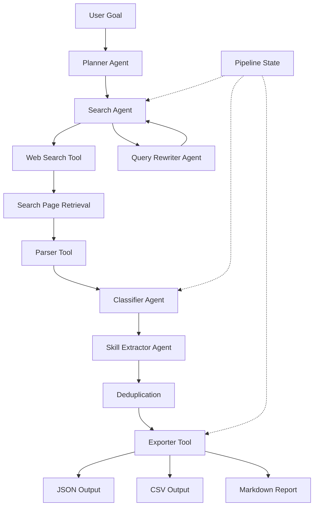

<div align="center">

# JobSeek AI Agent

### An Agentic Workflow for Intelligent AI Job Discovery and Automation

**AI Job Discovery · Multi-Agent Architecture · Web Automation · Intelligent Data Processing**

*Discovering and Organizing AI Career Opportunities Through Autonomous Agent Workflows*

<br>

[](https://www.python.org/)
[](https://github.com/Miraj-Rahman-AI/jobseek-ai-agent)
[](https://github.com/Miraj-Rahman-AI/jobseek-ai-agent)
[](LICENSE)
[](https://github.com/Miraj-Rahman-AI/jobseek-ai-agent)

</div>


## Overview

**JobSeek AI Agent** is a modular Python-based project designed to explore the application of Agentic AI architectures to automated job discovery, information extraction, and intelligent data organization.

The system provides an agent-oriented workflow that coordinates multiple specialized components to search for AI-related employment opportunities, process job information, identify relevant technical skills, filter unrelated positions, and generate structured datasets.

The project focuses primarily on discovering opportunities in areas such as:

- Artificial Intelligence Engineering
- Machine Learning Engineering
- Deep Learning Engineering
- Natural Language Processing (NLP)
- Computer Vision
- Large Language Models (LLMs)
- Generative AI
- Algorithm Engineering
- AI Research and Development

Rather than relying exclusively on manually constructed searches, the architecture incorporates task planning, query expansion, multi-source search orchestration, heuristic information extraction, and iterative processing.

**Project Status:** Research and development prototype. The repository contains modular agent and processing components, while parts of the live collection and LLM integration workflow remain under development.


## Motivation

Finding relevant AI engineering opportunities across multiple recruitment platforms can be challenging and time-consuming.

Job descriptions are distributed across different websites, presented in inconsistent formats, and frequently contain unrelated technical information.

Traditional job-search approaches require candidates to:

- Search multiple recruitment platforms individually.
- Construct different queries for different job categories.
- Read and compare numerous job descriptions.
- Identify relevant technical requirements.
- Extract important skills and qualifications.
- Organize job information manually.
- Remove duplicate opportunities.

JobSeek AI Agent explores how an agent-oriented architecture can automate and organize these activities through a modular information-processing workflow.

The long-term objective is to develop an intelligent job discovery assistant that can continuously identify, analyze, and organize relevant career opportunities.


## Key Features

### 1. Agent-Based Task Planning

The Planner Agent decomposes a high-level job-search objective into structured search queries and executable workflow steps.

Example objective:

```text
Find 50 AI Engineer internship and campus recruitment opportunities.
```

The planner generates initial search queries and defines the processing stages required to achieve the objective.

Current implementation: predefined query templates and deterministic planning logic.

### 2. Multi-Platform Job Discovery

The system includes source-specific search URL construction for several recruitment platforms.

Configured platforms include:

- LinkedIn
- Indeed
- Lagou
- Zhipin (Boss直聘)
- Liepin

The Search Agent generates search tasks by combining queries with enabled recruitment sources.

Platform accessibility, authentication requirements, and website restrictions may affect data retrieval.

### 3. Iterative Query Expansion

The Query Rewriter Agent expands the original search queries when the number of collected records is below the target.

Example:

```text
Initial Query:
AI Engineer Internship

Expanded Queries:
Machine Learning Engineer Internship
Deep Learning Engineer Internship
LLM Engineer Internship
NLP Engineer Internship
Computer Vision Engineer Internship
AI Engineer Campus Recruitment
```

The current implementation uses deterministic query expansion rather than autonomous LLM-based query generation.

### 4. Job Information Extraction

The Parser Tool provides heuristic-based extraction and normalization of job information.

The intended job record includes:

- Job title
- Company
- Location
- Salary
- Technical skills
- Job requirements
- Recruitment source
- Job URL

The parser uses HTML processing, text extraction, and predefined patterns.

### 5. AI-Related Job Classification

The Classifier Agent identifies potentially relevant AI engineering opportunities.

The current implementation uses keyword-based classification to identify technical domains such as:

- Machine Learning
- Deep Learning
- Natural Language Processing
- Computer Vision
- Large Language Models
- Generative AI
- Recommendation Systems

It also uses non-target role keywords to help filter unrelated positions.

### 6. Technical Skill Extraction

The Skill Extractor Agent identifies technical skills from available job information.

Example technical tags:

```text
Python
PyTorch
TensorFlow
Scikit-learn
Pandas
NumPy
OpenCV
NLP
Computer Vision
LLM
RAG
Transformers
LangChain
LangGraph
CUDA
MLOps
```

The current implementation uses a predefined technical vocabulary and keyword matching.

### 7. Data Cleaning and Deduplication

The system includes data-processing components for maintaining consistent job records.

Current capabilities include:

- Duplicate detection using job URLs.
- Fallback duplicate detection using title, company, and location.
- Text normalization.
- Salary normalization.
- Technical tag normalization.
- Job record validation.

### 8. Structured Data Export

The Exporter Tool supports generating structured job-search results.

Supported output formats:

| Format | Purpose |
|---|---|
| JSON | Machine-readable job records |
| CSV | Tabular job datasets |
| Markdown | Human-readable summary reports |

---

## System Architecture

JobSeek AI Agent follows a modular agent-oriented architecture that separates planning, search orchestration, information extraction, classification, and data processing.

### High-Level Architecture



*Note: This diagram represents the intended processing architecture. The current orchestrator does not yet implement complete extraction of individual job listings from recruitment search pages.*

### Architectural Components

| Layer | Components | Responsibility |
|---|---|---|
| Agents | Planner, Search, Classifier | Planning and task generation |
| Agents | Query Rewriter, Skill Extractor | Query expansion and skill identification |
| Tools | Web Search, Scraper | Web interaction and page retrieval |
| Tools | Parser, Exporter | Information extraction and output generation |
| Pipeline | Orchestrator | Workflow coordination |
| Pipeline | Job Pipeline | Job processing and deduplication |
| Pipeline | Pipeline State | Execution tracking and logging |
| Core | Models and Schemas | Structured data representation |
| Core | Normalizer and Validator | Data consistency and validation |
| Core | Deduplicator | Duplicate record detection |

### Agent Components

**PlannerAgent**
- Builds an execution plan.
- Generates initial search queries.
- Defines processing steps.

**SearchAgent**
- Creates search tasks.
- Distributes queries across enabled sources.
- Supports page-based task generation.

**ClassifierAgent**
- Identifies AI-related job postings.
- Filters potentially irrelevant roles.
- Provides classification explanations.

**QueryRewriterAgent**
- Expands existing queries.
- Generates alternative job-title combinations.
- Supports iterative search expansion.

**SkillExtractorAgent**
- Identifies technical skills.
- Enriches job records with technical tags.

### Tool Components

**WebSearchTool**
- Constructs source-specific search URLs.
- Retrieves search-page HTML.
- Supports batch search URL generation.

**ScraperTool**
- Fetches webpage HTML.
- Extracts readable webpage content.
- Identifies hyperlinks.

**ParserTool**
- Parses job-related information.
- Extracts selected fields using heuristic methods.
- Normalizes job records.

**SiteRouterTool**
- Manages enabled recruitment sources.
- Generates query-source routing tasks.
- Provides basic fallback source selection.

**ExporterTool**
- Generates JSON datasets.
- Generates CSV datasets.
- Produces Markdown reports.


## Technology Stack

### Programming Language

- Python 3.10+

### Agent and LLM Ecosystem

- LangChain
- LangGraph
- OpenAI API

These packages are included in the project dependencies. Their integration into the current execution workflow remains a development objective.

### Web Data Collection

- Requests
- BeautifulSoup4
- Selenium (dependency included; browser automation is not currently integrated into the main workflow)

### Data Processing

- Pandas
- Pydantic
- Regular Expressions
- JSON

### Development and Testing

- Pytest
- Python-dotenv
- Tenacity
- Git and GitHub


## Repository Structure

```text
jobseek-ai-agent/
│
├── README.md
├── LICENSE
├── requirements.txt
├── .env.example
├── .gitignore
├── main.py
│
├── agents/
│   ├── __init__.py
│   ├── planner_agent.py
│   ├── search_agent.py
│   ├── classifier_agent.py
│   ├── query_rewriter_agent.py
│   └── skill_extractor_agent.py
│
├── assets/
│   └── Agentic Al Job Search System.png
│
├── config/
│   ├── settings.py
│   └── constants.py
│
├── core/
│   ├── __init__.py
│   ├── models.py
│   ├── schemas.py
│   ├── deduplicator.py
│   ├── normalizer.py
│   └── validators.py
│
├── data/
│   ├── raw/
│   ├── processed/
│   └── sample/
│
├── docs/
│   ├── architecture.md
│   ├── workflow.md
│   └── interview_notes.md
│
├── examples/
│   ├── demo_run.py
│   └── example_output.json
│
├── output/
│   ├── jobs.json
│   ├── jobseek_ai_50_jobs.csv
│   └── report.md
│
├── pipeline/
│   ├── __init__.py
│   ├── orchestrator.py
│   ├── job_pipeline.py
│   └── state.py
│
├── prompts/
│
├── tests/
│   ├── __init__.py
│   ├── test_agents.py
│   ├── test_deduplication.py
│   ├── test_parser.py
│   └── test_pipeline.py
│
├── tools/
│   ├── __init__.py
│   ├── web_search_tool.py
│   ├── scraper_tool.py
│   ├── parser_tool.py
│   ├── exporter_tool.py
│   └── site_router_tool.py
│
└── utils/
```


## Installation and Setup

### 1. Clone the Repository

```bash
git clone https://github.com/Miraj-Rahman-AI/jobseek-ai-agent.git

cd jobseek-ai-agent
```

### 2. Create a Virtual Environment

```bash
python3 -m venv .venv
```

### 3. Activate the Virtual Environment

**macOS / Linux**

```bash
source .venv/bin/activate
```

**Windows**

```bash
.venv\Scripts\activate
```

### 4. Install Dependencies

```bash
python -m pip install --upgrade pip

pip install -r requirements.txt
```

### 5. Configure Environment Variables

Create your local environment configuration:

```bash
cp .env.example .env
```

Open `.env` and configure the required settings.

```env
# OpenAI Configuration
OPENAI_API_KEY=your_openai_api_key_here
OPENAI_MODEL=gpt-4o-mini
OPENAI_TEMPERATURE=0.2

# Search Configuration
TARGET_JOB_COUNT=50
MAX_ITERATIONS=10
REQUEST_TIMEOUT=20

# Output Configuration
OUTPUT_JSON=output/jobs.json
OUTPUT_CSV=output/jobs.csv

# Scraper Configuration
HEADLESS=true

# Recruitment Platform Configuration
ENABLE_LINKEDIN=false
ENABLE_INDEED=true
ENABLE_LAGOU=true
ENABLE_ZHIPIN=true
ENABLE_LIEPIN=true
```

**Note:** The OpenAI API configuration is provided for future LLM integration. The currently implemented rule-based workflow does not require an OpenAI API call.

Never commit your actual `.env` file or API credentials to GitHub.


## Running the Project

There are currently two execution entry points.

### Option 1: Basic Demonstration

Run:

```bash
python main.py
```

This entry point executes the placeholder pipeline and exports two hard-coded demonstration job records.

Generated files:

```text
output/
├── jobs.json
└── jobs.csv
```

### Option 2: Agent Orchestration Demonstration

Run:

```bash
python examples/demo_run.py
```

This entry point invokes the `JobSeekOrchestrator` and demonstrates the modular processing workflow.

The execution includes:

1. Building an initial execution plan.
2. Generating search tasks.
3. Attempting to retrieve recruitment search pages.
4. Processing demonstration or fallback page content.
5. Parsing job records.
6. Applying rule-based classification.
7. Extracting technical tags.
8. Removing duplicate records.
9. Exporting structured results.

Generated files:

```text
output/
├── jobs.json
├── jobs.csv
└── report.md

examples/
└── example_output.json
```

**Important:** The current orchestrator uses synthetic demonstration content and fallback records. Its output must not be interpreted as a verified collection of real job vacancies.


## Example Job Record

The project uses a structured dictionary representation for job information.

```json
{
  "title": "AI Engineer Intern",
  "company": "Example Technology",
  "location": "Beijing",
  "salary": "15K-20K",
  "tech_tags": [
    "Python",
    "PyTorch",
    "NLP",
    "LLM"
  ],
  "requirements": "Experience with machine learning and deep learning.",
  "source": "indeed",
  "job_url": "https://example.com/job/1"
}
```

The example above is illustrative and does not represent a verified vacancy.


## Testing

The repository includes unit tests for several core components.

Test coverage includes:

- Agent planning and task generation.
- AI-related job classification.
- Query expansion.
- Technical skill extraction.
- Job information parsing.
- Duplicate detection.
- Pipeline state management.
- Job processing.

Run the test suite:

```bash
pytest -q
```

To run individual test modules:

```bash
pytest tests/test_agents.py -v

pytest tests/test_parser.py -v

pytest tests/test_deduplication.py -v

pytest tests/test_pipeline.py -v
```

The tests use controlled examples and do not establish that live recruitment-platform scraping works reliably.


## Current Implementation Status

The project is under active development.

| Component | Current implementation |
|---|---|
| Planner Agent | Predefined query planning |
| Search Agent | Multi-source task generation |
| Query Rewriter | Rule-based query expansion |
| Classifier Agent | Keyword-based classification |
| Skill Extractor | Vocabulary-based extraction |
| Web Search Tool | Search URL generation and HTTP retrieval |
| Scraper Tool | Generic HTML retrieval |
| Parser Tool | Heuristic-based parsing |
| Deduplicator | URL and record-signature matching |
| Exporter | JSON, CSV, Markdown |
| LLM Integration | Not connected to the current workflow |
| Individual Job Detail Extraction | Requires further implementation |
| Selenium Browser Automation | Not integrated into the main workflow |

This distinction is important when evaluating the current capabilities of the repository.


## Future Development Roadmap

The following improvements are planned to move the prototype toward a more complete autonomous job discovery system.

### Phase 1: Advanced Web Data Collection

- Implement platform-specific job listing extractors.
- Extract individual job URLs from search results.
- Retrieve actual job detail pages.
- Improve HTML parsing and dynamic-content handling.
- Introduce robust retry and error-handling mechanisms.

### Phase 2: LLM-Based Agent Intelligence

- Integrate OpenAI models into the Planner Agent.
- Introduce LLM-based semantic job classification.
- Implement context-aware query rewriting.
- Improve technical skill extraction using LLMs.
- Develop intelligent job-description summarization.

### Phase 3: Advanced Job Intelligence

- Implement semantic job ranking.
- Introduce personalized job recommendations.
- Develop resume-to-job matching.
- Perform technical skill-gap analysis.
- Support multi-language job discovery.

### Phase 4: Advanced Agentic Automation

- Integrate LangGraph-based agent orchestration.
- Introduce persistent agent memory.
- Implement scheduled job discovery.
- Develop autonomous job monitoring.
- Introduce human-in-the-loop verification.


## Responsible Data Collection

When extending the web collection functionality, ensure that data collection:

- Respects the terms of service of recruitment platforms.
- Follows applicable website access policies and rate limits.
- Avoids unauthorized access and authentication circumvention.
- Minimizes unnecessary collection of personal information.
- Handles collected employment information responsibly.

The project is intended for research, education, and legitimate job discovery.


## Use Cases

Potential applications include:

- Automated AI job discovery.
- Internship and campus recruitment monitoring.
- AI engineering career research.
- Recruitment information aggregation.
- Technical skill analysis.
- Personalized career recommendation systems.
- Agentic AI workflow experimentation.


## Documentation

Additional project documentation is available in the `docs/` directory.

| Document | Description |
|---|---|
| [Architecture](docs/architecture.md) | System architecture and component design |
| [Workflow](docs/workflow.md) | Step-by-step processing workflow |
| [Interview Notes](docs/interview_notes.md) | Project overview and technical discussion |

## License

Please refer to the [LICENSE](LICENSE) file for the licensing terms of this project.


## Author

<div align="center">

### Mahabubur Rahman Miraj

**AI Researcher | Agentic AI | LLM Systems | Trustworthy AI**

[](https://github.com/Miraj-Rahman-AI)
[](https://www.linkedin.com/in/miraj-rahman-ai/)

</div>


---

<div align="center">

**JobSeek AI Agent**

*Exploring Intelligent Career Discovery Through Agentic AI.*


</div>
